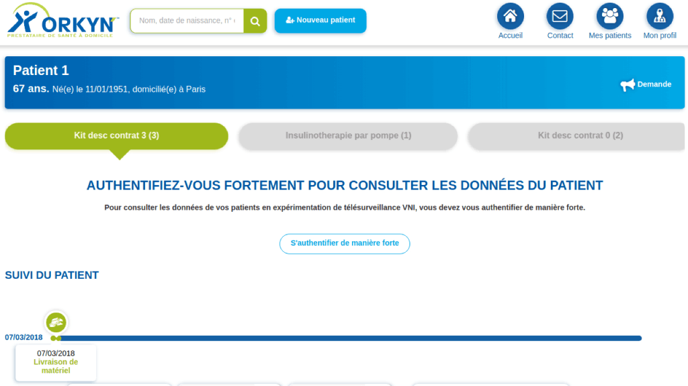
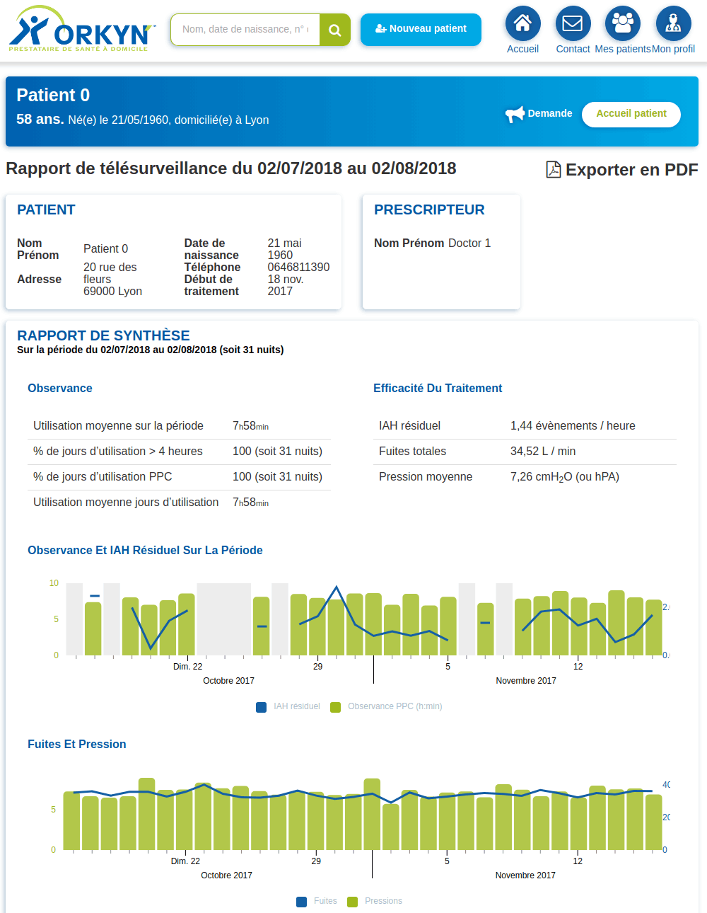

import Skill from '@site/src/components/skill';

# Air Liquide - Co-lead développeur Full Stack JS/TypeScript

> mai 2017 - mars 2018 · 11 mois
> \
> Paris · Sur site

Co-lead technique de l'équipe. Création d'un extranet pour des prescripteurs de soin d'aide à la respiration afin d'aider le suivi de leur patientèle pour les filiales santé d'Air Liquide

- Recherche des solutions techniques les plus adaptées
- Développement des microservices et du front-end du back-office prescripteurs
- Chargement de données de référence via l'API Google Sheets
- Gestion du multi-marques, un même développement étant utilisé pour générer 3 back-offices
- Génération de rapport suite à du monitoring de patient, en version web et PDF

## Taille d'équipe

- 3 développeurs
- 1 SM/PO (client)

## Compétences

- <Skill name="TypeScript" highlight={true} />
- <Skill name="Architecture microservices" highlight={true} />
- <Skill name="RabbitMQ" highlight={true} />
- <Skill name="Angular" highlight={true} />
- <Skill name="Linux" />
- <Skill name="PM2" />
- <Skill name="REST" />
- <Skill name="Express.js" />
- <Skill name="Node.js" highlight={true} />
- <Skill name="Puppeteer" highlight={true} />
- <Skill name="JavaScript" />
- <Skill name="Yarn" />
- <Skill name="Jira" />
- <Skill name="Méthodes agiles" />
- <Skill name="Scrum" />
- <Skill name="MongoDB" />
- <Skill name="Elasticsearch" />
- <Skill name="JSON" />
- <Skill name="Google Sheets API" />

## Images du projet

