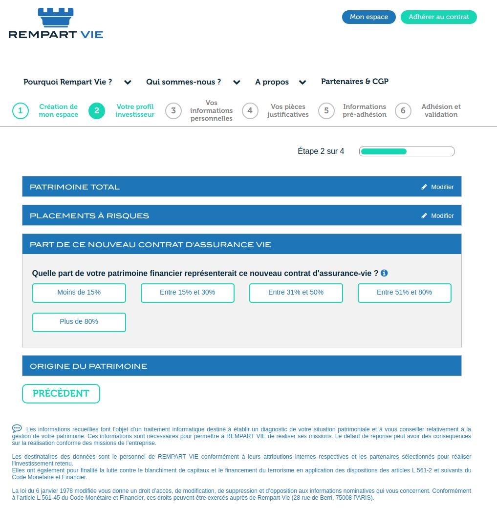

import Skill from '@site/src/components/skill';

# Rempart Vie - Développeur Full Stack JS

> février 2017 - mai 2017 · 4 mois
> \
> Paris · Sur site

Création d'un parcours de souscription d'une assurance-vie pour BDL Capital Management

## Taille d'équipe

- 3 développeurs
- 1 SM/PO (client)

## Compétences

- <Skill name="JavaScript" highlight={true} />
- <Skill name="TypeScript" />
- <Skill name="Express.js" highlight={true} />
- <Skill name="Node.js" highlight={true} />
- <Skill name="MongoDB" highlight={true} />
- <Skill name="Angular" highlight={true} />
- <Skill name="REST" />
- <Skill name="npm" />
- <Skill name="Jira" />
- <Skill name="Méthodes agiles" />
- <Skill name="Scrum" />
- <Skill name="JSON" />
- <Skill name="Linux" />

## Images du projet

