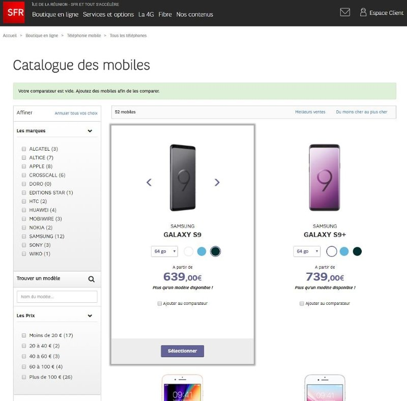
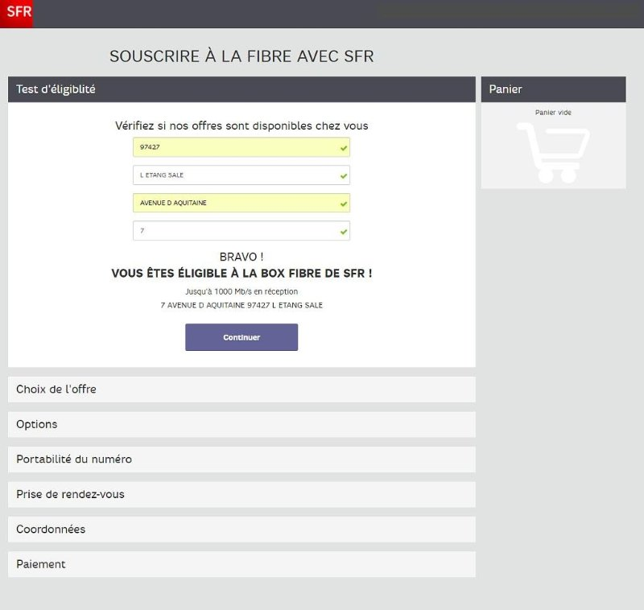

import Skill from '@site/src/components/skill';

# SRR (SFR Réunion & Mayotte) - Développeur Full Stack JS & Java

> mars 2016 - octobre 2016 · 8 mois
> \
> Paris · Sur site

- Création de la PDC Fibre & ADSL
- Maintenance de la boutique en ligne

## Taille d'équipe

- 1,5-2 développeurs
- 1 PPO & SM
- 1 PO (client)

## Compétences

- <Skill name="JavaScript" highlight={true} />
- <Skill name="MongoDB" highlight={true} />
- <Skill name="Java 8" />
- <Skill name="AngularJS" highlight={true} />
- <Skill name="Java EE" />
- <Skill name="Spring MVC" />
- <Skill name="Spring Data" />
- <Skill name="ES6" />
- <Skill name="REST" />
- <Skill name="Linux" />
- <Skill name="Scrum" />
- <Skill name="Jira" />
- <Skill name="Méthodes agiles" />

## Images du projet

