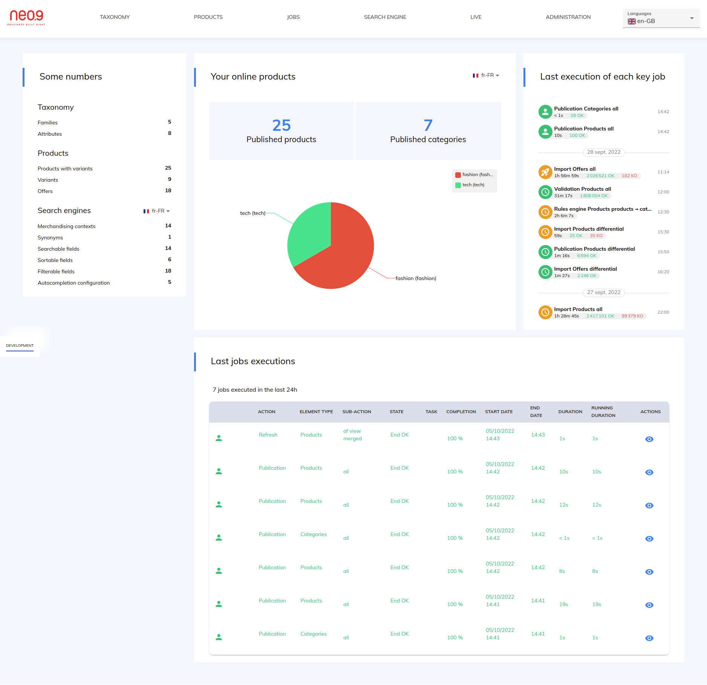
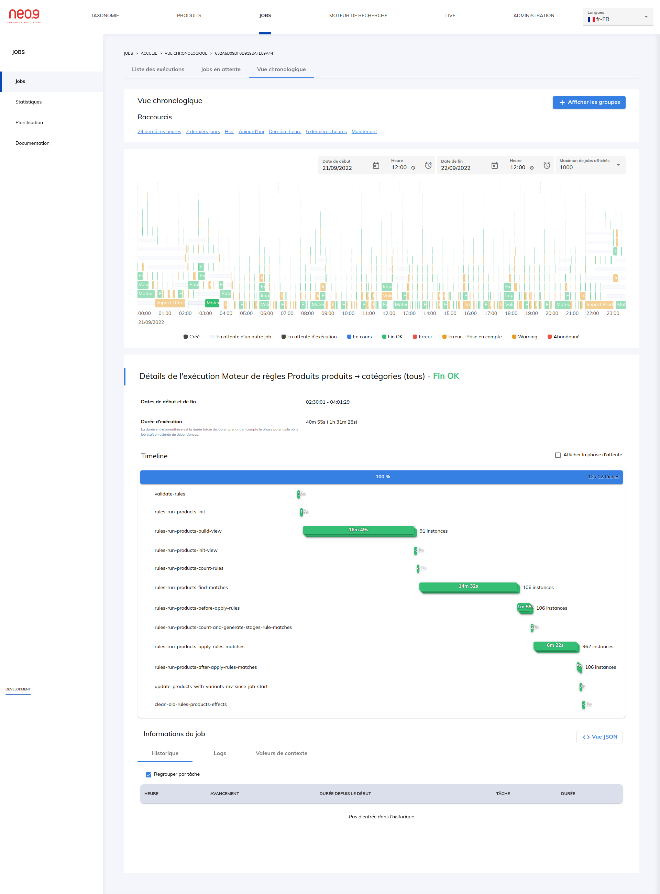
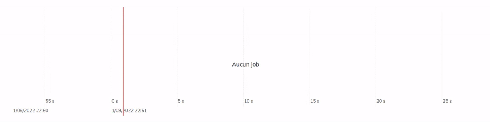

import Skill from '@site/src/components/skill';

# Lancement du produit - Architecte technique

> juin 2022 - novembre 2023 · 1 an 6 mois
> \
> Bordeaux · Télétravail

Dans le cadre d'un nouveau projet intégrant le produit, l'équipe a été doublée.

- Implémentation de la refonte complète du back-office, passage de Bootstrap à Angular Material
- Ajout de tests end-to-end sur le nouveau back-office
- Nouveau connecteur générique pour importer des produits d'Akeneo avec de nouveaux types d'attributs à gérer
- Gestion des promotions de façon générique afin de répondre à tous les besoins connus du marché
- Validation de la configuration de l'application à son démarrage
- Revue de la gestion de l'import des médias

## Taille d'équipe

- 7 développeurs
- 1 Product Owner
- 1 Scrum Master

## Compétences

- <Skill name="Elasticsearch" />
- <Skill name="Node.js" />
- <Skill name="TypeScript" highlight={true} />
- <Skill name="Playwright" highlight={true} />
- <Skill name="Angular" />
- <Skill name="RabbitMQ" />
- <Skill name="MongoDB" highlight={true} />
- <Skill name="Architecture microservices" />
- <Skill name="Angular Material" />
- <Skill name="Linux" />
- <Skill name="REST" />
- <Skill name="Grafana" />
- <Skill name="Newman" />
- <Skill name="Express.js" />
- <Skill name="JavaScript" />
- <Skill name="Yarn" />
- <Skill name="Docker" />
- <Skill name="Jira" />
- <Skill name="Kubernetes" />
- <Skill name="Méthodes agiles" />
- <Skill name="Prometheus" />
- <Skill name="Helm" />
- <Skill name="Postman" />
- <Skill name="Scrum" />
- <Skill name="GitLab" />
- <Skill name="Confluence" />
- <Skill name="Mirakl" />
- <Skill name="PlantUML" />
- <Skill name="Kibana" />
- <Skill name="Thanos" />
- <Skill name="Predator" />

## Images du projet

