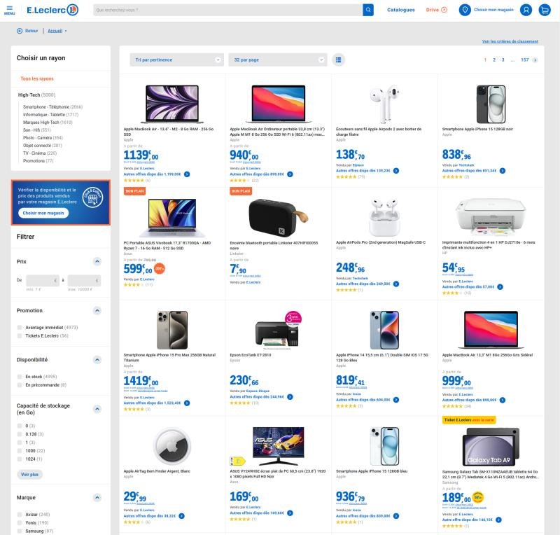
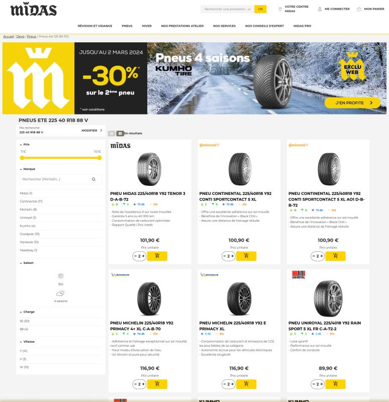
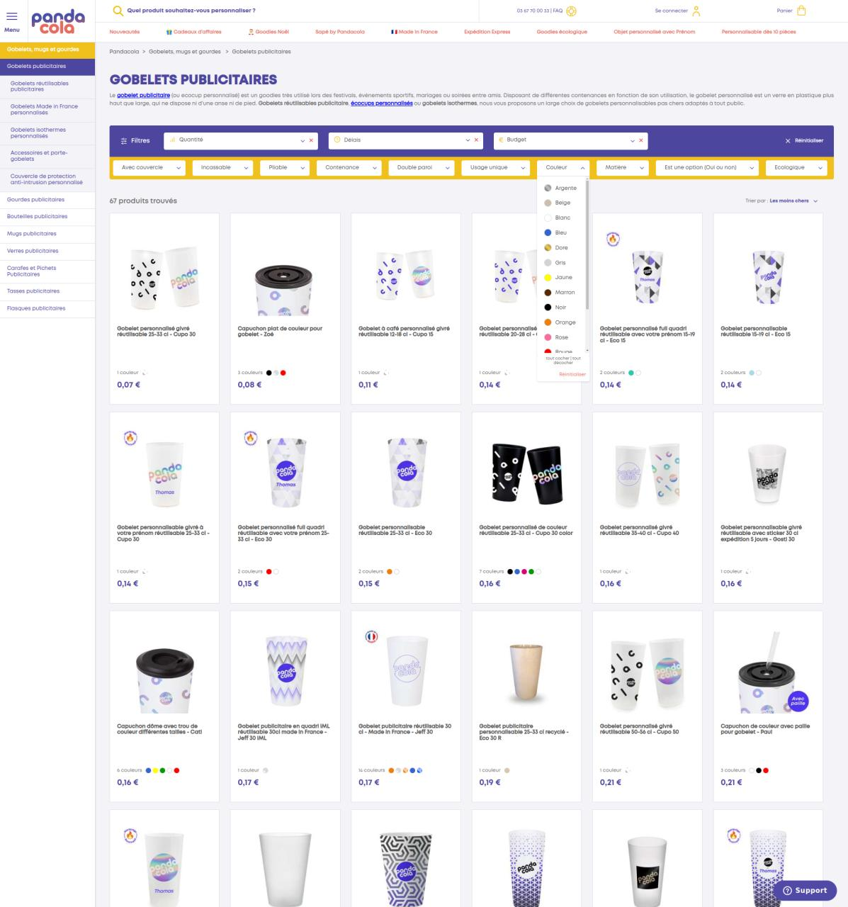

# Exemples de projets accompagnés utilisant le Catalogue Neo9

## [E.Leclerc](https://e.leclerc)

Principales fonctionnalités utilisées :

- Source des produits Mirakl MCM
- Source des offres Akeneo (prix des produits nationaux) & SI interne
- Moteur de catégorisation
- Règles de validité des produits
- Indexation des produits
- Export des produits pour un moteur de recherche externe

## [Midas.fr](https://midas.fr)

Principales fonctionnalités utilisées :

- Source des produits SI Midas (PIM custom)
- Règles de validité des produits
- Gestion de produits sans offres
- Ajout et correction d'informations dans le Catalogue Neo9
- Indexation des produits
- Moteur de recherche (filtres et faceting configurés)

## [Pandacola - Site de vente d'objets personnalisés](https://www.pandacola.com/mug-gourde-bouteille/gobelet-publicitaire?sort=price-asc)

Principales fonctionnalités utilisées :

- Source Mirakl MCI
- Multiples variantes par produit
- Moteur de catégorisation
- Gestion des médias avec optimisation pour le web
- Indexation des produits
- Moteur de recherche (textuelle, filtres, faceting...)

